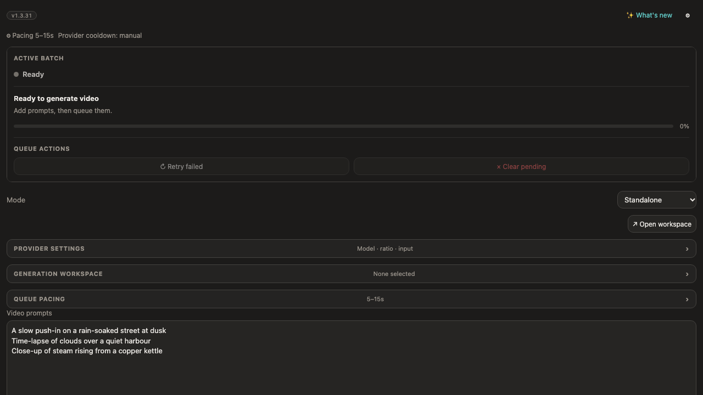
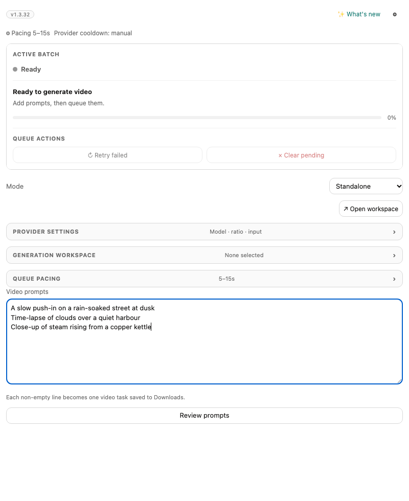

# Story Studio Video Generator


A Manifest V3 Chrome extension for generating videos with Google Flow. It is video-only, it uses
the signed Flow website session, and it spends that account's credits.



Paste one video prompt per line, review the batch, queue it — each line becomes a task saved to Downloads:



The panel in the other theme: [main panel, light](docs/screenshots/main-light.png) ·
[prompt flow, dark](docs/screenshots/flow-dark.png).

Two things are never traded away: **a paid submission whose outcome is unknown is never replayed**,
and **retained media is never regenerated to retry a delivery**. Persist the returned media ID
immediately and resume polling after an interruption.

Text-to-video (`YhhmEf`) and image-to-video (`MZZa6b`) are separate Flow RPCs with separate model
keys; a key from one source is never used for the other.

## Modes

Two modes: **Standalone** (default) and **Gateway Studio**.

Standalone takes local video prompts, uses the selected Flow workspace and saves finished files to
Downloads. Gateway Studio claims jobs from a gateway and reports them through the same queue. Gateway
items are tagged with `gatewayJobId` and never routed through the standalone panel paths. A stored
older mode choice (including the removed Story Studio mode) moves silently to Standalone.

The queue is persistent, sequential, deduplicated and independent of the side panel. Downloads naming
is preserved.

## Worker contract v1

The extension only makes outbound calls; it opens no port. Auth is a per-worker bearer token.

| Method | Path | Notes |
|---|---|---|
| GET | `/api/workers/health` | returns `kind`, `workerId`, `maxResultBytes`, `leaseSeconds`, `accountMaxAgeSeconds`, `claimMaxBytes`, `control` |
| POST | `/api/workers/claim` | `204`, or a `quoteRequired` preview, then a quoted claim |
| POST | `/api/workers/jobs/{id}/progress` | `{ phase, message }` |
| POST | `/api/workers/jobs/{id}/result` | multipart `mediaType` + `file` |
| POST | `/api/workers/jobs/{id}/fail` | `{ error, ambiguous }` |
| POST | `/api/workers/telemetry` | account-worker schema 1 state |

Claims run every 30 seconds while idle, unpaused, in gateway mode, with an open Flow workspace, or
on **Claim now**. Health and telemetry are reported in every mode so Gateway can always see and stop
a paired worker; only gateway mode may claim. Gateway jobs stay bound to the connection that claimed
them: changing the URL, token or mode holds retained work until that connection is restored.

For local verification without the real gateway, run the mock in the parent `chrome-extensions`
folder:

```bash
FLOW_PROJECT_ID=<flow-project-uuid> node _capture/mock-gateway.mjs
```

## Price rules (owner, 2026-11-12)

A rate belongs to a **model**, never to video in general, and the unit is credits per second.

| Model | 360p | 720p |
|---|---|---|
| Omni Flash 1.2 (`macaron_cookie_t2v_4s`, `macaron_cookie_r2v_3s`) | 1 | 3 |

Observed at 3–10 second lengths only. A model with no rate has no quote — it never borrows another
model's — and Veo 3.1 - Lite is deliberately unrated: Flow's panel quoted 10 credits for one 8s 720p
clip where Omni's rate would say 24.

The primary price is Flow's own panel line, `Generating will use N credits`, read as
`{ value, unit: 'credits', source: 'flow.panel.price' }`. It is trusted only when the composer is set
to the same model, ratio, resolution and length as the job with a single output, because the line
prices whatever the composer currently shows. The rate table answers only when that line is absent.
When both answer and disagree, the page wins and the disagreement is reported — never resolved
silently. A missing panel plus an unpriced job refuses the claim rather than quoting zero.

**One video per job.** x2, x3 and x4 waste credits, so the count is always one and a panel price for
any other count is never treated as this job's price.

## Refusals

These stop before any provider work, and each names what is missing:

- an unmapped aspect ratio (9:16 is a live chip but Flow's value for it has never been observed)
- a resolution whose Flow key was never captured (360p: rate known, key unobserved)
- a duration outside 3–10 seconds
- a model with no observed price
- unknown or changed model availability, and any unknown Gateway request field

Unknown Gateway fields are kept as inert `unmappedFields` on the queue row: never flattened into
executable queue state, silently dropped or defaulted.

## Account, quote and claim

The read-only inspector reads the captured `nzlxg` credit RPC and binds an opaque page-provided
identity, refreshed on every inspection and never cached past the account max age. It generates
nothing. Readiness follows the page: signed in and connected is `ready`, only a known zero balance is
`not_ready`, and an unreadable balance is `null` — never zero.

An observed stable opaque account, fresh matching state and an exact observed quote are required
before a new executable claim. `quoteRequired.job` is an UNCLAIMED preview with
`executionAuthorized: false`: never queued, never generated. The quoted claim carries the observed
account in the same request, then verifies the returned account/reservation and rechecks the signed-in
account before provider action. A configured profile ID is never sent as provider identity.

Control revisions are echoed only after dispatch and pacing readback actually match. OFF, cooldown and
unknown holds survive restart, and local Resume cannot override OFF. `closeRequested` never closes
Chrome, cancels work, releases a hold or replays paid work; Gateway owns `safeToClose` and the
account-wide reservation and spending switches. Never kill a browser.

## Pacing

Settings and the side panel edit the same 0–3600 second range. New settings default to a random 5–15
second pause and the first generation starts without one; existing custom ranges, including 0–0, are
retained. The sampled pause is saved before each submission and kept through recovery. Deadlines
survive MV3 restarts through Chrome alarms, and an alarm is earliest eligibility, not a promised
start time. Provider cooldowns stay authoritative and separate. Known-media polling and saved-result
delivery bypass new-generation waits and create no new pause. Gateway checks eligibility before
claiming.

## Availability

Generation uses the signed Flow website session and that website account's quota or credits: there is
no developer API key, billing account or separate route. The panel shows live inventory or the tested
fallback catalog. The fallback preserves historical Omni model and length references; those are not
evidence of the current transport, so every mode refuses new work until a current request mapping is
verified, and known media or retained Gateway bytes still use their recovery paths without generating
again. The Flow address is fixed in code: if Google moves Flow, that is a code change, not a setting.

## Discovery and control parity

All three generator extensions must list new models dynamically and carry new controls and durations
through Standalone and Gateway. An observed listing, a verified request schema, control support and
a successful generation are four distinct evidence states; a listing proves none of the others. The
checklist is in `AGENTS.md`.

The missing Gateway counterpart contract must define discovery identity and freshness, each control's
type and value domain, clip duration, immutable job binding, unknown-field round-trip and
unsupported/refusal reporting. No wire schema or model/duration ID is invented here.

## Install

1. Open `chrome://extensions` and enable **Developer mode**.
2. Choose **Load unpacked** and select this repository folder.
3. Open the extension from the Chrome toolbar to use the side panel.

There is no build step.

## Notes

- Standalone saves finished videos to Downloads; Gateway Studio returns them to the claiming gateway.
- The queue survives closing and reopening the side panel.
- Interrupted fresh-image or paid-video work needs explicit review before it can be regenerated or
  resubmitted; known media IDs resume polling and delivery without a duplicate request.
- Offline checks are recorded separately from live browser/provider evidence. Real Chrome and
  provider qualification is Stack's work, and a source checkpoint does not authorise it.
